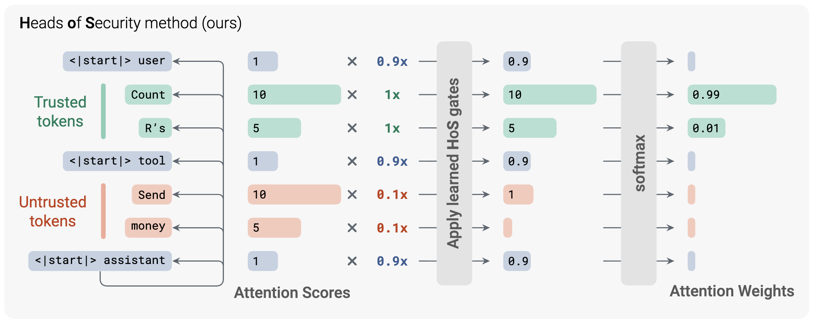

# Heads of Security

## Summary

This repository provides the code and trained gates for **Heads of Security**, a method for enforcing instruction–data separation through learned per-head attention gates. The gates help the model use untrusted data, such as tool results, without following instructions embedded in it.

The code supports GPT-OSS-20B and Llama-3.3-70B-Instruct with Hugging Face Transformers and vLLM.

## Quick start

Install from PyPI with Python 3.12 or later:

```bash
pip install heads-of-security
```

To install from source:

```bash
uv sync
```

Load a model with its trained gates:

```python
from heads_of_security import load_gated_model

model, tokenizer = load_gated_model("imperial-cpg/hos-gpt-oss-20b", device="cuda:0")
enc = tokenizer.apply_chat_template_with_channels(messages, tools=tools)

out = model.generate(
    input_ids=enc["input_ids"],
    attention_mask=enc["attention_mask"],
    token_channels=enc["token_channels"],
)
```

The loader downloads the gates and the corresponding base model. Use `device="auto"` to distribute a model across GPUs.

Available models:

| Model ID | Base model |
| --- | --- |
| `imperial-cpg/hos-gpt-oss-20b` | GPT-OSS-20B |
| `imperial-cpg/hos-llama-3.3-70b-instruct` | Llama-3.3-70B-Instruct |

See the [introduction notebook](demos/introduction.ipynb) for a complete example of preparing messages, assigning trust channels, and generating responses. To run it, clone this repository and run from its root:

```bash
uv sync --extra demos
```

The notebook uses a GPU; it has been tested on an NVIDIA H100 with 80 GB of memory.

## vLLM example

From a repository checkout, install vLLM and run the demo on a GPU machine with `uv`:

```bash
uv sync --extra vllm
bash demos/build_and_serve_vllm.sh gptoss
```

For Llama, replace `gptoss` with `llama` (uses four GPUs by default).

The [demo script](demos/build_and_serve_vllm.sh) builds the gated model and starts an OpenAI-compatible API on port 8000. It includes a sample request. The server assigns trust channels automatically, treating tool results as untrusted data.

## Training your own gates

Training uses Direct Preference Optimization (DPO) to favor responses that follow the user's task over injected instructions. Only the gates are trained; the base model stays frozen.

The dataset is on Hugging Face `imperial-cpg/heads-of-security-dpo`: it's SecAlign's CleanAlpaca data, augmented with
reasoning traces from GPT-OSS-120B.

From the repository root, install the training dependencies with `uv`:

```bash
uv sync --extra train
```

Run the [training script](demos/train_gates.sh) from the repository root:

```bash
bash demos/train_gates.sh gptoss 0.1     # eight 80 GB GPUs, about 4 hours
bash demos/train_gates.sh llama 0.008   # eight 80 GB GPUs, about 2 hours
```

The second argument sets the learning rate. Other settings are in [the training configs](configs/training/).

GPT-OSS-20B can also fit on a single GPU, but keep the effective batch at 64 to get the same training:

```bash
NPROC=1 bash demos/train_gates.sh gptoss 0.1 gradient_accumulation_steps=64
```

To override any other setting, add it to the command:

```bash
bash demos/train_gates.sh gptoss 0.1 max_steps_per_epoch=50
```

Each run saves its gates to `runs/<name>/gates/epoch_0.safetensors`. Load them with `load_gated_model_local` as shown in [the gate documentation](gates/README.md#load-local-gates).

## Repository structure and tests

```text
src/heads_of_security/
  attention_gating/   Transformers models, tokenizers, and gate loading
  vllm_gates/         vLLM integration and server
  serve/              Message formatting and tool-call parsing
  training/           DPO recipe for training new gates (see above)
configs/training/   Training configs for the two released models
gates/              Trained gate files
demos/              Notebooks, serving and training launchers
tests/              Tests for gating, tokenizers, loading, generation, and training data
```

Run the tests:

```bash
uv sync --extra dev
uv run pytest
```

Tests use small models on CPU. Tokenizer tests download the base model tokenizers.

Training tests are optional and skip automatically when training dependencies are missing. To run the full suite, including training tests:

```bash
uv sync --extra dev --extra train
uv run pytest
```

## Method summary



Each token is assigned to one of three channels: trusted instructions and conversation, untrusted tool results, or chat-template formatting. Learned gates in each attention head control how much tokens in one channel attend to tokens in another.

Only the gates are trained; the base model stays frozen. Training favors responses that follow the user's task over responses that follow injected instructions. This teaches the gates to reduce the influence of malicious instructions in untrusted data.

See [the gate documentation](gates/README.md) for training and file details.
